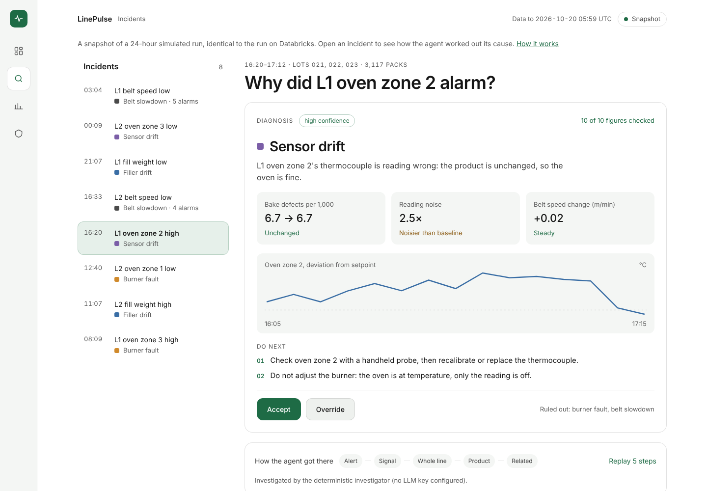
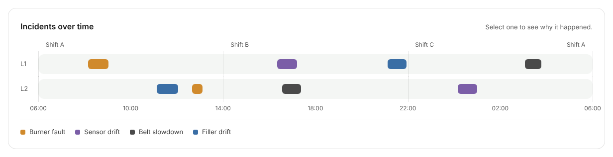
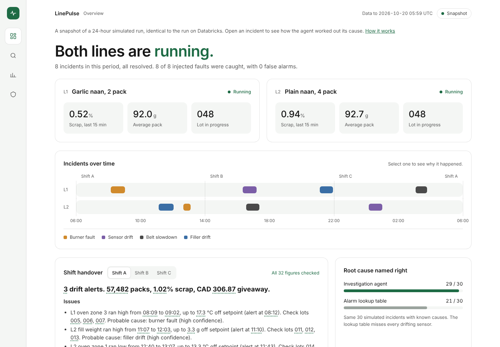

# LinePulse

[](https://github.com/feliciachen01/linepulse/actions/workflows/ci.yml)
[](https://feliciachen01.github.io/linepulse/)

Real-time quality and waste monitoring for a (simulated) bakery line: a Databricks
lakehouse that turns line telemetry into drift alerts, shift KPIs and recall-ready
lot lists, served by a .NET 8 API and dashboard. Runs entirely on free tiers.

**[Open the live demo](https://feliciachen01.github.io/linepulse/)**: a static snapshot of the
dashboard over 24 simulated hours, identical to the run on Databricks. Open any incident to see the agent's diagnosis and replay how it
worked it out.

[](https://feliciachen01.github.io/linepulse/)

- **Incident-investigation agent:** an alarm says *what* drifted; the agent works out *why*. It
  gathers evidence through tools over the gold tables, names a root cause, rules others out and
  recommends actions. Scored on 240 injected incidents with known causes: an alarm lookup table
  gets **177**, and gets every drifting thermocouple wrong
- **Live on Databricks Free Edition:** 8/8 injected faults caught, mean 10.4 min, 0 false alarms in 24 h, identical to the local run
- **Measured, not claimed:** 30/30 faults across 10 simulated shifts; every bad record quarantined
- **Shift-handover agent:** an LLM writes the end-of-shift note through tool calls, including each
  alert's probable cause, and a checker confirms every number, time and lot ID came from the tools
- **Stack:** Auto Loader, Delta, Unity Catalog, Spark Structured Streaming, .NET 8 minimal API, GitHub Actions

> **Simulated data.** Two naan lines, injected faults with known root causes, deliberate
> bad records and duplicate deliveries. Because every fault is injected on purpose, detection
> is *scored*, not claimed. All plant numbers are illustrative assumptions, not FGF data.

### The simulated day

Each fault has a root cause, and each cause leaves a different footprint across the line's
signals. That matters because the same alarm, "oven zone 2 running hot", can have three causes:

| Root cause | What the sensors show | What the product shows |
| --- | --- | --- |
| Burner fault | one zone hot or cold | bake defects rise |
| Thermocouple drift | one zone reads hot or cold, and noisier | nothing changes: the oven is fine |
| Belt slowdown | belt speed drops, every zone reads hotter (less dough load) | fewer packs per minute, bake defects rise |
| Filler drift | pack weight moves | giveaway (heavy) or underweight rejects (light) |

The default 24-hour day (seed 7) injects eight faults. Shift A's three are unchanged from the
first release, so its results below stay comparable; shifts B and C add five more, including
two lines alarming on a hot oven zone 19 minutes apart for different reasons (a drifting
thermocouple on L1, a slowing belt on L2). Over the full day: **8 / 8 faults detected, mean
10.4 min, 0 false alarms**. The slowest catch is the drifting thermocouple (23 min): it creeps
up slowly by design.

## Results (one simulated 8-hour shift, 86,879 events)

| What | Result | How it is measured |
| --- | --- | --- |
| Faults detected | **3 / 3** | `scorecard.json` vs `ground_truth/faults.json` |
| Detection latency | **mean 8.3 min, max 12 min** after fault onset | first alert's `detected_at` - fault onset |
| False alarms | **0** | alerts that overlap no injected fault |
| Bad records quarantined | **179 / 179** | `silver_quarantine` vs injected count |
| Duplicate deliveries removed | **479 / 479** | bronze - silver - quarantine |
| Incremental = batch | **identical** gold tables from 1 run or 8 runs | `run_local.py --chunks 8` |
| Local pipeline run | ~31 s per shift (laptop, Spark local mode) | wall clock |

Per fault: slow oven-zone drift (+15 °C over 20 min) caught in 12 min; filler creeping
3 g heavy caught in 10 min; burner step (-12 °C) caught in 3 min. The 10-minute target
was missed for the slow ramp. That is a property of the EWMA + 3-minute confirmation
rule, and the threshold sweep below shows the trade-off.

### Across 10 shifts (`python scripts/evaluate_seeds.py --seeds 10`)

One shift is an anecdote, so the full pipeline is rerun for 10 simulator seeds: the same
three faults, with different sensor noise and process wander each time.

| Metric | Result |
| --- | --- |
| Faults detected | **30 / 30** |
| Detection latency | mean **8.5 min**, p50 9, p90 13, max 14 |
| False alarms | **0** in all 10 shifts |
| Quarantine and dedup exact | in every shift |

| Fault | Fastest | Slowest |
| --- | --- | --- |
| F1 slow oven drift (+15 °C over 20 min) | 7 min | 14 min |
| F2 filler creeping 3 g heavy | 8 min | 11 min |
| F3 burner step (-12 °C) | 3 min | 5 min |

**Threshold trade-off** (false alarms summed over the 10 shifts):

| Oven / fill threshold | Mean latency | False alarms |
| --- | --- | --- |
| 3 °C / 1.0 g | 7.0 min | 182 |
| 4 °C / 1.0 g | 7.9 min | 4 |
| **5 °C / 1.0 g (default)** | **8.5 min** | **0** |
| 5 °C / 0.6 g | 7.7 min | 51 |
| 8 °C / 1.0 g | 10.4 min | 0 |

The single-shift sweep made 4 °C look free (0 false alarms). Across 10 shifts it costs 4,
which is why the default is 5 °C: supervisors stop trusting an alarm that cries wolf, and
the extra 0.6 min of latency is cheap by comparison.

### Live run on Databricks Free Edition

The same pipeline on Databricks serverless (Auto Loader, Delta, Unity Catalog) over the default
**24 simulated hours**: three shifts and eight faults with root causes, including the two lines
alarming on a hot oven for different reasons.

| Metric | Live result |
| --- | --- |
| Events ingested | 259,517 |
| Faults detected | **8 / 8** |
| Detection latency | mean **10.4 min**, max 23 (the slowly drifting thermocouple, F4) |
| False alarms over 24 h (defaults 5 °C / 1.0 g) | **0** |
| Bad records quarantined | **524 / 524** |
| Duplicate deliveries removed | **1,335 / 1,335** |
| Pipeline run (bronze → silver → gold) | 119 s on serverless |
| Matches the locally tested pipeline | **identical**: scorecard and all 15 threshold-sweep rows equal a local run of the same 1,440 minutes |

| Oven / fill threshold | Mean latency | False alarms in 24 h |
| --- | --- | --- |
| 3 °C / 1.0 g | 8.5 min | 49 |
| 4 °C / 1.0 g | 9.6 min | 2 |
| **5 °C / 1.0 g (default)** | **10.4 min** | **0** |
| 5 °C / 0.6 g | 9.6 min | 19 |
| 8 °C / 1.0 g | 13.1 min | 0 |

An earlier live run of the original three-fault day also matched its local run exactly
(3/3 detected, mean 8.3 min, 0 false alarms).

Getting there took two serverless-only fixes the local tests could not see, both now
covered by regression tests: functions shipped to workers must not reference a module
imported from a Git folder (its workspace loader cannot be pickled), and the sweep must
handle a run where no fault has started yet.

### Live dashboard (.NET 8 API on the Databricks SQL warehouse)

[This screenshot](docs/dashboard-live.png) is the API on the live warehouse (earlier page design). The API runs in a GitHub Codespace and reads the gold tables through the Databricks SQL
Statement Execution API with a personal access token. The dashboard shows both lines, the
three drift alerts with the lots made during each excursion, and KPIs for all three shifts.

| Request (`GET /api/alerts`) | Time |
| --- | --- |
| First call: live query to the SQL warehouse | 1.40 s |
| Next calls: served from the API's 60 s cache | 2-5 ms |

The cache is there because gold only changes when the pipeline runs; every cache hit is a
query the Free Edition warehouse does not have to run.

## Incident-investigation agent

A drift alert says "L2 oven zone 1 is running hot". The supervisor needs to know what to do about
it: call maintenance for the burner, recalibrate a thermocouple, check the belt drive, or leave the
oven alone. In the simulated day, two lines alarm on a hot oven within 20 minutes of each other: on
L1 the oven is fine and its thermocouple is drifting; on L2 the belt is slowing down. Adjusting
either burner would make things worse.



**How it works** (`src/linepulse/investigate.py`):

1. **Evidence tools over gold.** `get_alert`, `get_signal_window` (shape of the excursion, reading
   noise vs a baseline hour), `compare_line_signals` (every oven zone, belt speed, proofer, fill weight,
   before vs during), `get_product_quality` (packs per minute, bake-defect and underweight rejects per
   1,000), `get_related_alerts` (same line, other line, history). Tools return pre-computed changes and
   ratios so the model never does arithmetic.
2. **A structured diagnosis.** Root cause (`burner_fault`, `thermocouple_drift`, `belt_slowdown`,
   `filler_drift` or `unclear`), confidence, evidence, causes ruled out and why, recommended actions.
   The model is given a plant troubleshooting guide (what a sensor fault vs a real process change looks
   like), not rules about this data.
3. **Checked like the handover.** Every figure in the diagnosis must appear in a tool result; one
   correction round, then "needs review". No API key, or the API fails: a deterministic investigator
   with the same tools takes over.
4. **Recorded and replayed.** Each run is stored step by step (why, which tool, what came back). The
   dashboard replays it, then the supervisor can **Accept** or **Override** with the cause they found
   (`POST /api/investigations/{alertId}/review`). Because the data is simulated, the page then shows the
   injected ground truth.

**How often it is right** (`python scripts/evaluate_investigations.py --days 30`): 30 random simulated
days, 240 incidents with random causes, lines, zones, directions and sizes. Each incident's first alert
is investigated and scored against the injected root cause.

| Method | Correct root cause |
| --- | --- |
| Alarm lookup table (oven alarm = burner, belt = belt, fill = filler) | 177 / 240 (74%) |
| Deterministic investigator | 239 / 240 |
| **LLM agent** (Gemini 3.5 Flash-Lite, free tier), first 30 incidents | **29 / 30**, with 365 / 365 figures verified |

| True cause | Incidents | Lookup table | Deterministic investigator | LLM agent (of 30) |
| --- | --- | --- | --- | --- |
| Burner fault | 76 | 76 | 76 | 7 / 7 |
| Thermocouple drift | 60 | **0** | 59 | 8 / 9 |
| Belt slowdown | 51 | 48 | 51 | 8 / 8 |
| Filler drift | 53 | 53 | 53 | 6 / 6 |

On the same 30 incidents the lookup table got 21 right.

Read this honestly. The lookup table is what an alarm list gives you without investigating: right
whenever the alarm's signal is the cause, wrong on every drifting sensor. The deterministic
investigator was written by the same person who wrote the simulator, so its score mostly shows the
evidence is sufficient; it is the fallback, not the point. Its one miss is instructive: a 3-minute
alert covered only 180 packs, and 4 random bake defects looked like a threefold rise.

The LLM agent is the real test, because it only gets general plant knowledge, not the simulator's
rules. It named 8 of 9 drifting thermocouples, every one of which the lookup table gets wrong, and
every figure it wrote checked out. Its miss: an alert 49 minutes into the data, so the baseline hour
held only 29 minutes. Bake defects went from 3.5 to 5.3 per 1,000 packs (a noise-level change) and
the reading was 2.6 times noisier, and the model called a burner fault. Thirty incidents is a small
sample (the free tier allows a few hundred requests a day, about 5 per investigation), so read
29 / 30 as "about as good as the hand-written rules", not as a precise rate. It is evaluated on
demand and the result committed:

```bash
GEMINI_API_KEY=... python scripts/evaluate_investigations.py --days 30 --llm-max 30 --save docs/investigation_eval.json
```

The dashboard's accuracy section reads `docs/investigation_eval.json`. The `pages` workflow
investigates the demo day's alerts with the LLM on every deploy when `GEMINI_API_KEY` is set.

## Shift-handover agent

At the end of each shift the incoming supervisor needs four things: what drifted, when, which
lots to check, and how the shift went. The agent writes that note, including each alert's probable
cause from the investigation agent.



1. **Tools, not raw data.** The model gets five read-only tools over the gold tables
   (`list_shifts`, `get_shift_kpis`, `get_shift_alerts`, `get_line_status`, `get_data_quality`)
   and is told to copy figures from them, never compute or estimate.
2. **Every figure is checked.** After the model answers, a checker extracts every number, clock
   time, date and lot ID from the note and matches it against the tool results (allowing only the
   rounding the note shows, so 17.27 may be written 17.3).
3. **One correction round.** If a figure is not found, the model is told which ones and asked to
   rewrite once. Still wrong: the note is published marked "needs review", with the bad figures
   highlighted in red on the dashboard.
4. **Graceful fallback.** With no API key, or if the API fails, a fixed template writes the note
   from the same tools, and the dashboard says so.

The dashboard shows the result: checked figures have a dotted underline, the header says how many
were checked, and "How this note was written and checked" lists the tool calls.

```bash
python scripts/run_local.py --minutes 1440               # gold tables
GEMINI_API_KEY=... python scripts/investigate_alerts.py  # or no key: deterministic investigator
GEMINI_API_KEY=... python scripts/generate_handover.py   # or no key: template writer
```

**Model.** It uses any OpenAI-compatible chat API (`LLM_BASE_URL`, `LLM_MODEL`, `LLM_API_KEY`).
The default is Google's Gemini API (`gemini-3.8-flash`), whose free tier needs no credit card.
Google retires models for new keys over time and free-tier limits differ a lot by model (Gemini
3.8 Flash allows about 20 requests a day; Flash-Lite models allow far more), so run
`python scripts/list_models.py` to see what your key can use, then `export LLM_MODEL=<name>`. For
the `pages` workflow, set it as a repository variable `LLM_MODEL` (**Settings > Secrets and
variables > Actions > Variables**).
To use it for the live demo, create a key at Google AI Studio and add it to the repo under
**Settings > Secrets and variables > Actions** as `GEMINI_API_KEY`. The `pages` workflow then
writes the notes with the LLM on every deploy. Free-tier prompts may be used by Google to
improve its products; the data here is simulated. Databricks Free Edition cannot call LLM APIs,
so notes are generated outside Databricks and the API serves them from a file in both modes.

## How it works

```
simulator ──JSON files──> landing (UC volume)
                              │  Auto Loader, Trigger.AvailableNow
                              ▼
                        bronze_events          raw + file + ingest time, append-only
                              │  foreachBatch: DQ rules, MERGE on event_id
                 ┌────────────┼──────────────┐
                 ▼            ▼              ▼
        silver_telemetry  silver_units  silver_quarantine (failed rule names)
                 └──────┬─────┘
                        ▼  per-minute means -> EWMA (applyInPandas) -> gaps-and-islands
   gold_signal_minute · gold_alerts (+ affected lots) · gold_quality_minute · gold_shift_kpis · ...
                        │  Databricks SQL Statement Execution API (parameterized, cached 60 s)
                        ▼
              .NET 8 minimal API  ──>  dashboard (served by the API)
                        ▲
   investigation agent + handover agent (LLM tool calls over gold, outside Databricks) ──> JSON files
```

Databricks Free Edition cannot call LLM APIs, so both agents run outside it (a laptop, a Codespace,
GitHub Actions) on the exported gold tables, and the API serves what they wrote in both modes.

## Run it locally (no cloud account needed)

Needs Python 3.11+, Java 17+, .NET 8 SDK - or open the repo in **GitHub Codespaces**
(the devcontainer installs all three).

```bash
pip install -r requirements.txt
python scripts/run_local.py --minutes 480 --chunks 8 --sweep   # simulate a shift, build gold, print scorecard
pytest -q                                                       # 35 tests, ~2 min
cd api/LinePulse.Api && dotnet run                              # open http://localhost:5000 (port printed on start)
```

To rebuild the static demo: `python scripts/run_local.py --minutes 1440` then
`python scripts/build_static_demo.py` (writes `site/`). The `pages` workflow does this on every
push to `main` and publishes it to GitHub Pages.

If Spark cannot download the Delta jar (no access to Maven), add `--engine parquet`;
everything runs the same, with MERGE emulated by an anti-join.

## Run it on Databricks Free Edition

1. Sign up at Databricks Free Edition (no credit card). Non-commercial use only.
2. **Workspace > Create > Git folder**, paste this repo's URL.
3. Run `notebooks/00_setup` once (creates `workspace.linepulse` and the `raw` volume).
4. Attach each notebook to **Serverless** compute (the only option on Free Edition).
5. Run `01_simulate` (default 60 minutes of data), then `02_pipeline`, then `03_evaluate`.
   Repeat 01 → 02 to watch alerts appear incrementally. Set `minutes` = 480 for a full
   shift. Changing a widget can re-run the notebook: to stop that, set the widget panel's
   gear icon to "Do nothing" on widget change. Each run of 01 appends more data.
6. Optional: **Jobs > Create job** with tasks 01 → 02 → 03 on a 15-minute schedule, or
   deploy `databricks.yml` with the Databricks CLI. Keep it paused when you are not demoing:
   going over Free Edition quota stops compute until the quota resets.

### Point the API at Databricks

Create a personal access token (**Settings > Developer > Access tokens**) and copy your SQL
warehouse ID (**SQL Warehouses > your warehouse > Connection details**). Then:

```bash
export DATABRICKS_HOST=https://<your-workspace>.cloud.databricks.com
export DATABRICKS_TOKEN=<token>          # never commit this
export DATABRICKS_WAREHOUSE_ID=<id>
LinePulse__Mode=Databricks dotnet run --project api/LinePulse.Api
```

## API

| Endpoint | Returns |
| --- | --- |
| `GET /health` | `{status, mode}` |
| `GET /api/lines` | status per line: latest zone temps, fill weight, 15-min scrap, open alerts |
| `GET /api/lines/{lineId}/status` | one line (404 if unknown, 400 if malformed) |
| `GET /api/alerts?lineId=&status=open\|closed&limit=` | drift alerts with affected lots and packs in window |
| `GET /api/shifts?lineId=` | shift KPIs: scrap %, rejects by reason, giveaway g/pack, kg, CAD |
| `GET /api/signals/{lineId}/{signal}?minutes=` | per-minute mean, EWMA deviation, threshold |
| `GET /api/data-quality` | quarantined records by rule |
| `GET /api/handover` | shift-handover notes with figures checked/total, unverified figures, tool calls |
| `GET /api/investigations` | one row per alert: probable cause, confidence, who investigated, review |
| `GET /api/investigations/{alertId}` | the recorded investigation: steps, diagnosis, figure check, ground truth |
| `POST /api/investigations/{alertId}/review` | `{"decision": "accept"}` or `{"decision": "override", "root_cause": ..., "note": ...}` |
| `GET /api/investigations/evaluation` | diagnosis accuracy vs injected causes (lookup, rules, LLM) |

Inputs are validated against allow-lists and all SQL is parameterized.

## Design decisions (and the questions they answer)

- **Why medallion layers?** Bronze keeps exactly what arrived, so silver logic can change
  and be replayed without re-ingesting. Gold is the only layer the API may read.
- **Why micro-batch, not continuous streaming?** Serverless supports only
  `Trigger.AvailableNow`. Minutes of latency suits scrap and giveaway decisions; a safety
  interlock would belong in the PLC, not the lakehouse.
- **Why quarantine instead of drop?** A QA lead can audit every rejected record and the
  rule it failed. "Silently dropped" is how plants lose trust in data.
- **Why MERGE on `event_id`?** Gateways deliver at-least-once. MERGE makes reruns and
  re-sent events idempotent, which the tests prove.
- **Why EWMA before ML?** No labels needed, explainable to plant staff, and it sets the
  baseline any model must beat. The sweep makes the threshold a business decision.
- **Why affected lots on every alert?** Recall scope is the expensive question after an
  excursion; answering it in seconds is the point.
- **Why check the LLM's numbers instead of trusting it?** A handover with one wrong lot number
  is worse than no handover. Grounding the model in tools narrows what it can say; the checker
  proves what it did say, and the result is visible to the supervisor, not hidden in a log.
- **Why compare against a lookup table?** It is what an alarm list already gives a supervisor
  for free. An investigation has to beat it to be worth reading, and the per-cause table shows where:
  the alarms whose signal is not the cause.
- **Why replay recorded runs instead of investigating live in the page?** The public demo must not
  hold an API key, and a recorded run is auditable: the same steps a supervisor watched are the
  steps that were scored.
- **Why cache in the API?** Gold only changes when the pipeline runs; each cache hit is a
  query the Free Edition warehouse does not run.

## Tested here

- 35 pytest tests: chunked simulation equals a single run, each root cause leaves its own
  footprint (a drifting sensor never changes the product), the pandas reference gold equals Spark
  gold, the investigation agent against a fake LLM server (steps recorded, an invented figure sent
  back and corrected, a non-JSON answer or API error falling back to rules), DQ rules name every failure,
  end-to-end detection + idempotent rerun, Spark and pandas detectors agree, shipped
  functions pickle without importable modules, sweep handles runs with no alerts,
  static demo files match the API's responses, and the handover agent (against a fake LLM
  server): tool use, a hallucinated figure caught and fixed on retry, one left wrong marked for
  review, API failure falling back to the template.
- The pipeline also runs over **Spark Connect** with workers that cannot import the
  package, the same condition as Databricks serverless.
- API: 22 smoke checks in Local mode (including investigation reviews), and in Databricks mode against a fake Statement
  Execution API (`tests/fake_databricks.py`) that returns the real response shape.
- Live on Databricks Free Edition serverless: results identical to the local run (above).
  The .NET API has served the live gold tables from the Databricks SQL warehouse (above).

## Next steps

1. Azure Event Hubs (Kafka endpoint) as the ingestion source instead of files.
2. A second line whose feed uses different field names, to exercise `_rescued_data`
   schema-drift quarantine (the legacy-plant integration problem).
3. MLflow-tracked anomaly model compared against the EWMA baseline on the same scorecard.
4. Score the handover agent over many runs (share of notes fully verified, retries needed),
   the same way the detector and the investigation agent are scored.
5. Harder incidents for the investigation agent: two causes at once on one line, and a gas-supply
   fault that hits both lines (the "shared cause" `get_related_alerts` already looks for).

## Layout

```
src/linepulse/   simulator, pipeline (bronze/silver/gold), store (UC or local), evaluate,
                 investigate (investigation agent), handover (agent), reference (pandas gold for fast scoring)
notebooks/       Databricks notebooks: 00 setup, 01 simulate, 02 pipeline, 03 evaluate, 99 reset
scripts/         run_local.py (whole pipeline on your machine), evaluate_seeds.py, investigate_alerts.py,
                 evaluate_investigations.py, generate_handover.py, build_static_demo.py, smoke_api.sh
docs/            screenshots, investigation_eval.json (the committed diagnosis scorecard)
tests/           pytest suite + fake Databricks SQL endpoint
api/             .NET 8 minimal API + dashboard (wwwroot)
databricks.yml   optional Asset Bundle for the scheduled job
```
